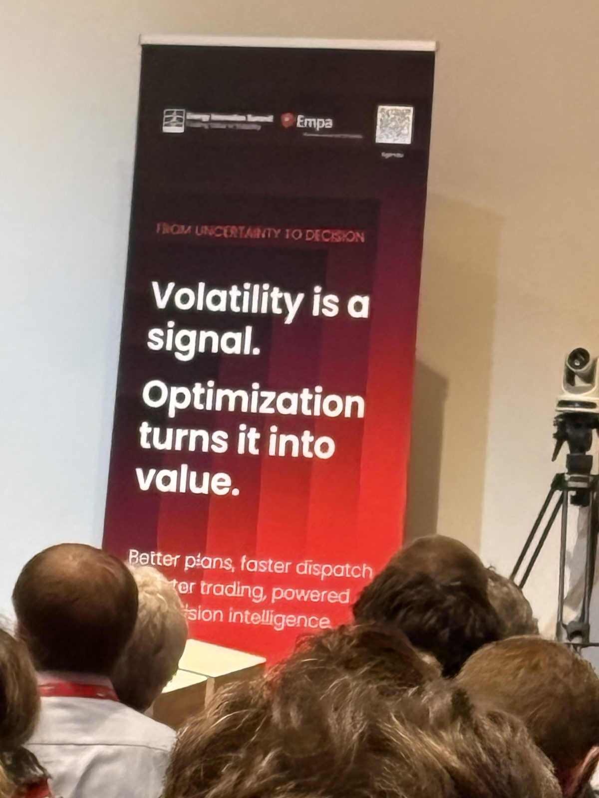
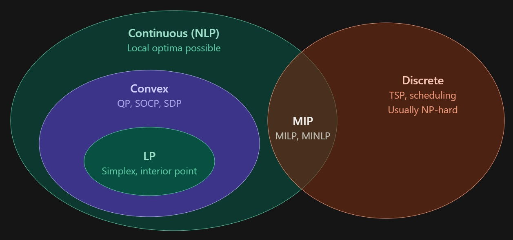
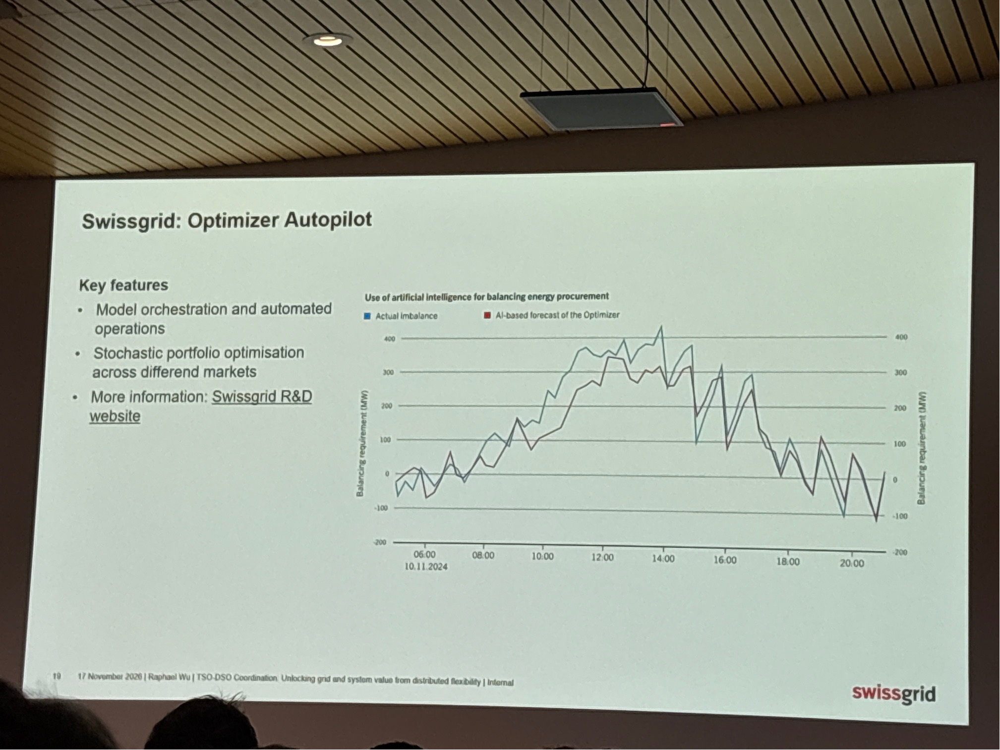
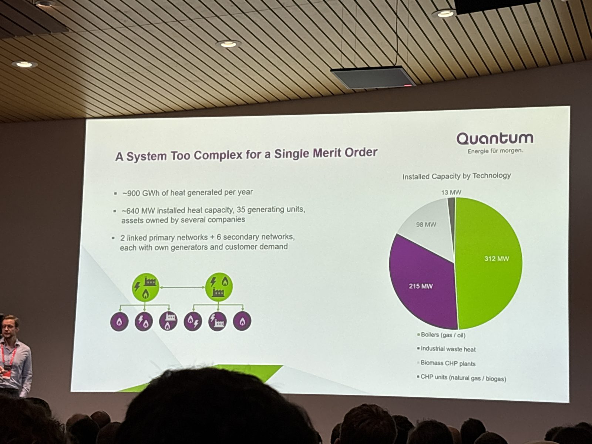
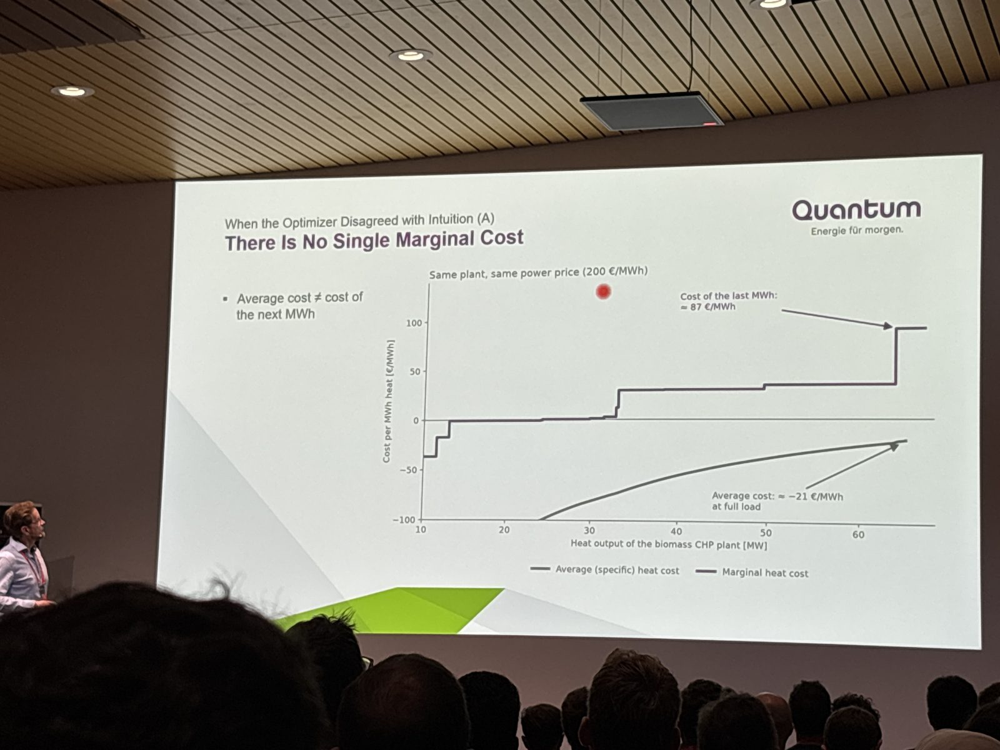
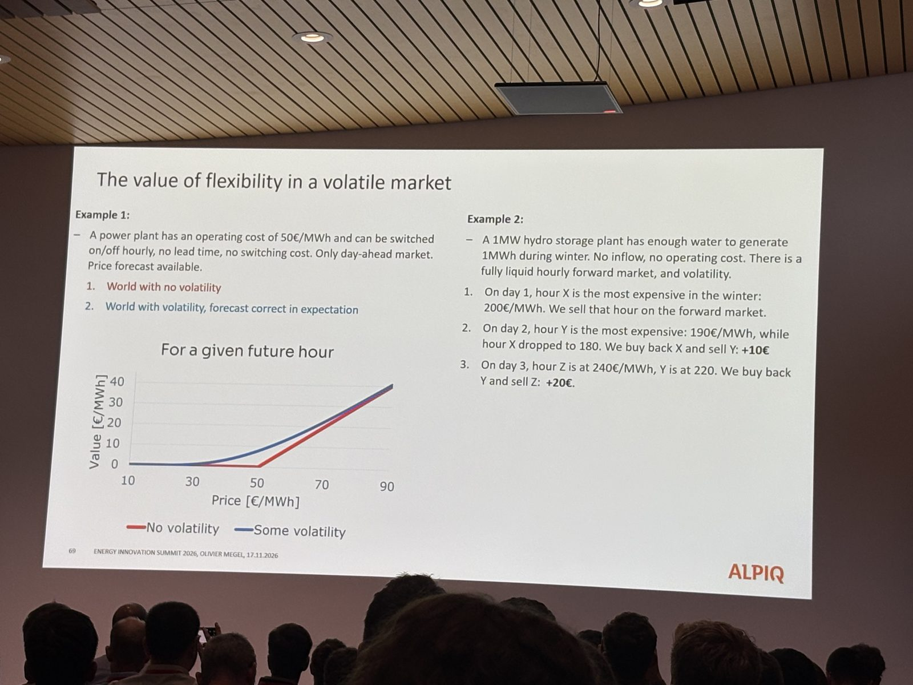
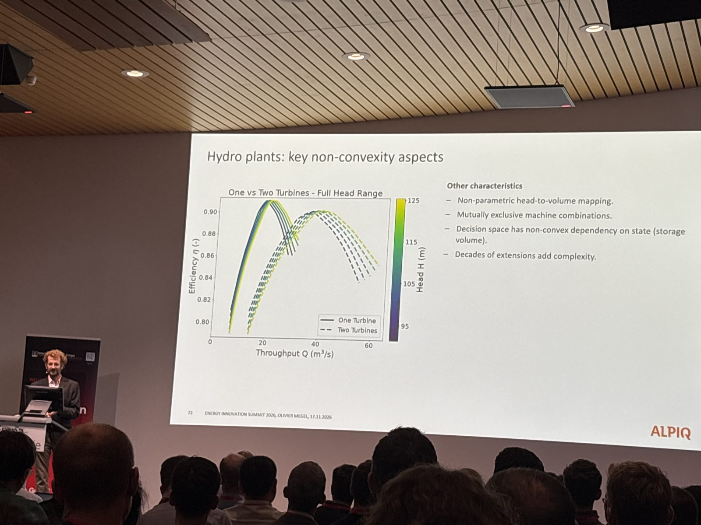
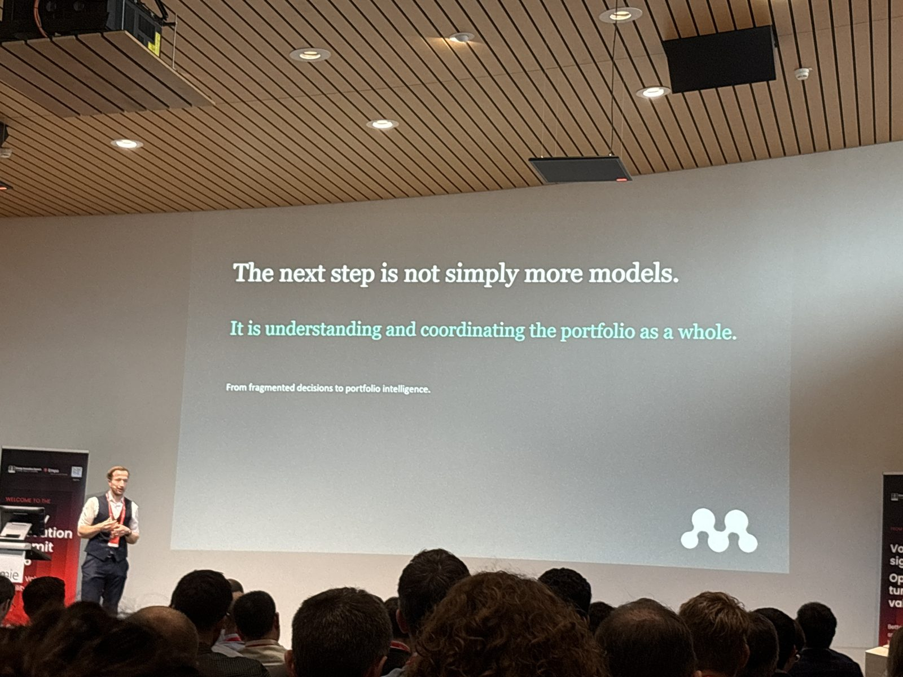

<!-- .slide: class="title-slide" data-session="none" -->

# Notes from the 2026 Energy Innovation Summit

<p class="subtitle">Daniel Hjertholm</p>

---

<!-- .slide: class="content-slide intro-slide" data-session="none" -->

<div class="cols cols-media cols-media-portrait">
<div>

<!-- <p class="eyebrow">General</p> -->

## Energy Innovation Summit 2026

- Organized by Gurobi (optimization software company) and Empa (The Swiss Federal Laboratories for Materials Science and Technology)
- 7th Gurobi summit (some of these have been TSO-specific and/or grid-focused)
- Focus on optimization utilized on energy systems
- Presentations from both industry and academia
- Day 1: Energy first. Day 2: Optimization first.
- 222 attendees (TSOs, utilities, BSPs, traders)
- Framing: Volatility requires optimization. Opportunity, not just something to manage / tame.

</div>
<div>



</div>
</div>

---

<!-- .slide: class="content-slide intro-slide" data-session="none" -->

<div class="cols cols-media cols-media-portrait">
<div>

## Optimization?

- ~Gradient methods~
- ~Dynamic programming~
- ~Bayesian optimization~
- Mathematical programming / mathematical optimization


</div>
<div>

<div class="r-stack">


</div>

</div>
</div>

---

<!-- .slide: class="talk-title-slide" data-session="d1-welcome" -->

# Welcome: Context Setting, Housekeeping, and Gurobi and Empa Team Presentation

<p class="speakers">
Tim Reintgen, Gurobi, Account Manager Power &amp; Utilities EME<br>
Georgios Mavromatidis, Empa, Head of Urban Energy Systems Laboratory
</p>

- Need to adapt to changes.
- Interdisciplinary.

---

<!-- .slide: class="content-slide tso-dso-slide" data-session="d1-tso-dso" -->

<div class="cols cols-media">
<div>

## TSO-DSO Coordination: Unlocking Grid and System Value from Distributed Flexibility

- Swissgrid-lead pilot project to show how TSO and DSOs can cooperate on utilizing decentralized flexibility.
- Motivation:
  - Flexibility increasingly comes from decentralized energy resources. Batteries, PV, heat pumps, EVs.
  - Shared market

</div>
<div>


</div>
</div>

---

<!-- .slide: class="content-slide tso-dso-slide" data-session="d1-tso-dso" -->

## Refresher on how Norway does this (👌🧂)

- DSOs purchase flexibility through EuroFlex on NODES platform. Only for congestions / voltage, not balance.
- Leftovers can be (automatically?) offered on the mFRR EAM market.
- Nordic Libra uses mFRR only, not EuroFlex products
- Statnett manages congestion in transmission and regional grid only (ABOT ignores constraints on components below a certain voltage level).

---

<!-- .slide: class="content-slide tso-dso-slide" data-session="d1-tso-dso" -->

<div class="cols cols-media">
<div>

## Market

- One joint TSO-DSO flexibility market
- Pay-as-bid preferred
- Two products
  - Power increase / decrease (completely new, mFRR-like)
  - Power limitation (e.g. limit an EV bus charger to 10 kW even though it was pre-qualified as flex up to 25 kW)
- Both products have activation and reservation markets (🤯)
- Products can be linked (mutually exclusive)
- DSOs define local market areas with
  - registered resources
  - interface node (transformer to transmission)
  - neighbouring local areas
  - LFS - load flow sensitivities (to both interface node and neighbouring local areas (👌🧂))

</div>
<div>


</div>
</div>

---

<!-- .slide: class="content-slide" -->

## Clearing and optimization

2-stage clearing:

- Stage 1:
  - A DSO submits a limitation request at a specific connection point
  - Matched with limitation bids at that point
- Stage 2:
  - Increase/decrease requests from all SOs (TSO and DSOs) are matched with increase/decrease bids
  - Respects mutual exclusivity
  - Respects net position limits

Settlement: It's complicated …

---

<!-- .slide: class="content-slide" -->

<div class="cols cols-media">
<div>

## Also: Optimizer autopilot

- Still Swissgrid. Different project. Not using the new piloted markets.
- AI monitors imbalance real-time and automatically procures flexibility across markets (mFRR and aFRR)
- Operators only supervise
- "Stochastic portfolio optimization"
  - stochastic = using scenarios to account for uncertainty (👌🧂)
  - portfolio optimization = multiple markets, trying to avoid price jumps in one market (👌🧂)

</div>
<div>

</div>
</div>

---


<!-- .slide: class="content-slide" -->

## Takeaways

- Talk together! Create working groups (direct encouragement from the presenter)
- Keep it simple

---

<!-- .slide: class="content-slide merit-order-slide compressed-2" data-session="d1-merit-order" -->

<div class="cols cols-media">
<div>

<p class="eyebrow">Technology Layer</p>

## From Spreadsheet Merit-Order to System-Wide Optimization

<p class="speakers">
Sebastian Angerhausen, Stadtwerke Krefeld / Quantum
</p>

<div>

Quantum pools energy (heat, gas, electricity) for trading + optimization services

### Challenge

- Optimize across energy types

### Old process

- Spreadsheets
- Daily planning
- Fixed internal heat prices per company per day: rational for each company ≠ best outcome for the system
- Could not react to intraday price volatility
- Could not represent interactions

</div>

</div>
<div>



</div>
</div>

---

<!-- .slide: class="content-slide merit-order-slide" -->

<div class="cols cols-media">
<div>

<div>

### New process

- System-wide optimization
- Quarter-hourly
- Feeds into downstream trading

### Input

- Forecasts for prices and heat demand

### MOSES

- In-house optimization library
- Mathematical Optimization for Simulation of Energy Systems

</div>

</div>
<div>



</div>
</div>

---

<!-- .slide: class="content-slide surrogate-slide compressed-1" data-session="d1-surrogate-models" -->

<div class="cols cols-media">
<div>

<p class="eyebrow">Technology Layer</p>

## Embedded Surrogate Models for Real-Time Optimization of Industrial Energy Systems

<div>

### Problem

- Optimize a larger plant / industrial site combining energy sources (CHP)
- Complex relationships: steam, heat, power generation, fuel constraints, emission limits, etc.
- Continuously find optimal setpoints (fuel cost, electricity cost, steam demand, CO2 costs)
- All modeled in a thermodynamic simulator
- But: simulation too slow (a few seconds) for an optimization loop

</div>

</div>
<div>


</div>
</div>

---

<!-- .slide: class="content-slide compressed-2" -->

<div class="cols cols-media">
<div>

<div>

### Solution

- Train neural nets on each modeled component, from simulator-generated synthetic data (surrogate model)
- With ReLU, the NN is piecewise linear
- Turn model into constraints in an optimization model
- Plant setpoints (CHP load, boiler operation, grid import / export) → decision variables
- Add business constraints (CO2 emissions, etc.)
- Add objective (maximize electricity revenue, minimize CO2 costs, etc.)
- Solve!

PS: `gurobi-ml` can now do this, but was not used here

</div>

```plaintext
Simulation
    v
Neural nets
    v
Physical constraints
    v
optimization of setpoints <--- Business constraints
    ^
Business objectives
```

</div>
<div>


</div>
</div>

---

<!-- .slide: class="content-slide surrogate-slide" -->

<div class="cols cols-media">
<div>


<div>

### Free side effects

- Other uses. Seconds → milliseconds. As accurate as the simulation
- Can be tweaked when real equipment drifts
- Anomaly detection

</div>

</div>
<div>


</div>
</div>

---

<!-- .slide: class="content-slide alpiq-slide compressed-2" data-session="d1-innovation-talk" -->

<div class="cols cols-media">
<div>

<p class="eyebrow">Market Layer</p>

## Innovation in Practical Action Talk

<p class="speakers">
Olivier Megel, Alpiq
</p>

- How to exploit flexibility as a producer, given volatility, e.g. through long-term options
- Volatility always good as producer
- Combine physical and financial trade
- Dynamic programming (likely use, simplified):
  - Question: sell water now, or save for later?
  - Split into stages (hours / weeks). State = reservoir level
  - Solve backwards from the end: for each level, best choice = income now + value of remaining water
  - Result: water value. Run when price > water value, otherwise save
  - Uncertain prices / inflow → stochastic DP (SDDP)

</div>
<div>

<div class="r-stack">


</div>

</div>
</div>

---

<!-- .slide: class="content-slide eneco-slide compressed-2" data-session="d1-portfolio-intelligence" -->

<div class="cols cols-media">
<div>

<p class="eyebrow">Market Layer</p>

## Optimizing Value in Volatility: From Fragmented Decisions to Portfolio Intelligence

<p class="speakers">
Quinten de Wit, Eneco
</p>

- Eneco. Virtual power plant (VPP): wind, batteries, CHP, heat systems and boilers
- VPPs often handled using multiple optimization models: one for trading, dispatch, scheduling, flexibility
- Instead: portfolio intelligence
- How? Digital twins + MILP
- "The future of energy optimization may not be built on more models. It may be built on a better understanding of the portfolio as a whole."

</div>
<div>



</div>
</div>

---

<!-- .slide: class="content-slide takeaways-slide" data-session="summary-takeaways" -->

<p class="eyebrow">Summary</p>

## My takeaways

### What I saw at the summit

- Many have similar challenges to Statnett => get inspiration
- "Everything" can be seen as optimization. Not from the marketing people, but from the technical people, who were almost tripping over each other to say "but you can solve that more simply with optimization".
- Insatiable demand for optimization. As the tools get better, actors find new ways to fill the extra capacity.
- Lots of focus on portfolio management.
- Variability in solve time is very often just due to randomness. Compare data variability against seed variability before concluding that the data is the cause.

---

<!-- .slide: class="content-slide takeaways-slide" -->

<p class="eyebrow">Summary</p>

## My takeaways

### For Statnett

- Several people asked me how transparent Statnett is. Strong wish from market participants for more info about the state of the power system, incl. bottlenecks and capacities.
- Go to more conferences with other TSOs or other actors in the power industry.
