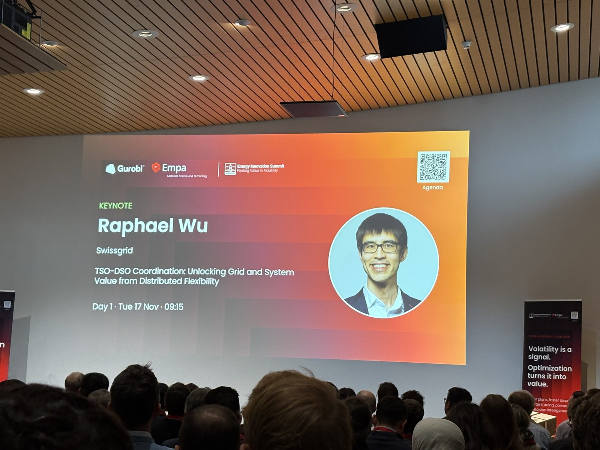
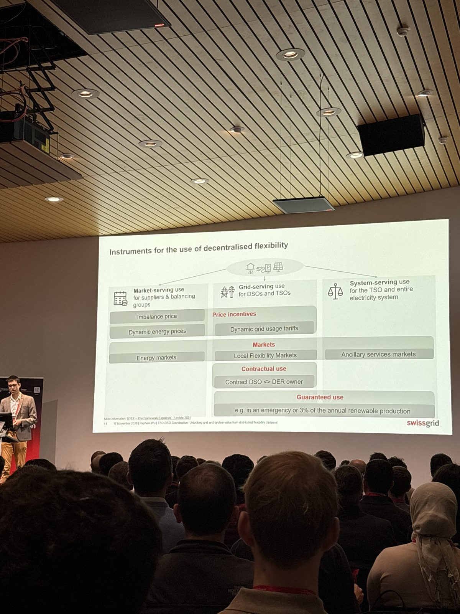
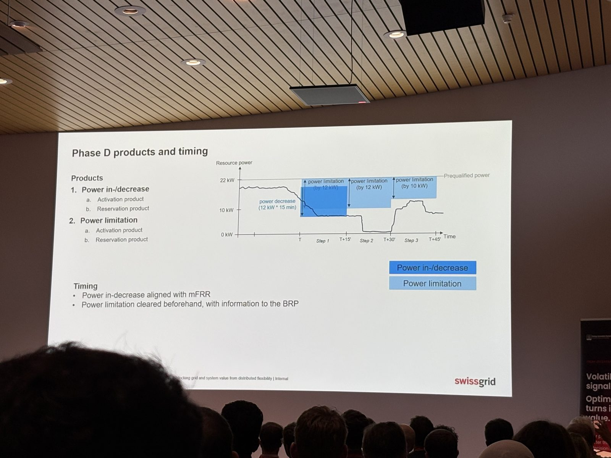
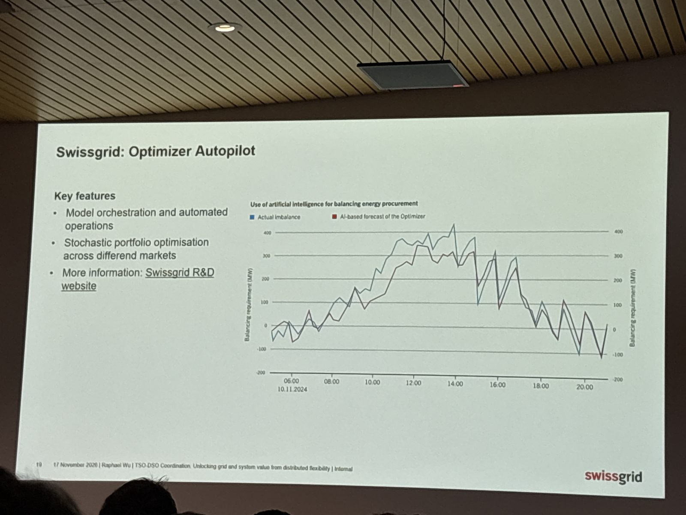

<!-- .slide: class="talk-title-slide" data-session="d1-welcome" -->

Welcome

# Welcome: Context Setting, Housekeeping, and Gurobi and Empa Team Presentation

Tim Reintgen, Gurobi, Account Manager Power &amp; Utilities EME 
Georgios Mavromatidis, Empa, Head of Urban Energy Systems Laboratory

---

<!-- .slide: class="content-slide" -->

- Need to adapt to changes.
- Interdisciplinary.

---

<!-- .slide: class="talk-title-slide" data-session="d1-tso-dso" -->

Keynote

# TSO-DSO Coordination: Unlocking Grid and System Value from Distributed Flexibility

Raphael Wu, Swissgrid, Principal Specialist Market Strategy

---

<!-- .slide: class="content-slide" -->

Flexibility increasingly comes from the distribution grid.

---

<!-- .slide: class="content-slide" -->

How to optimise across these use cases?

---

<!-- .slide: class="content-slide" -->

- Project where DSO, TSO and BSPs look for opportunities to cooperate.
- Solution takes constraints both from DSO and TSO into account.
- DSO main buyers of flexibility in Switzerland.

---

<!-- .slide: class="content-slide" -->

- DSOs provide sensitivities at the transformer where they connect to the transmission grid.
- Quite classical optimisation, but with a little extra aggregation of local flexibility.
- 2 stage. What is not used locally goes on to a larger market where Swissgrid trades.

---

<!-- .slide: class="content-slide" -->

Have working groups!

Questions

- Do DSOs have access to mFRR EAM in Norway? Do they use other, more local markets?
- Is this mFRR, aFRR or something else? → Just like tertiary, but something slightly different.
- Are DSOs already making use of flexibility?
- Talks about Statnett's variant. More one-way.

---

<!-- .slide: class="content-slide" -->

A completely different project

### Questions

- Tertiary reserves?
- Said "control energy". For congestion management purposes or balance.

